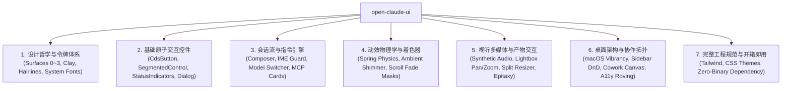

# Open Claude UI (`open-claude-ui`)

<p align="center">
  
</p>

<p align="center">
  <strong>Production-grade, clean-room reverse-engineered implementation of the Claude Design System (CDS) and interaction physics.</strong>
</p>

<p align="center">
  <a href="LICENSE"></a>
  <a href="https://github.com/morluto/rea"></a>
  <a href="assets/README.md"></a>
  <a href="https://www.typescriptlang.org/"></a>
  <a href="https://react.dev/"></a>
  <a href="https://tailwindcss.com/"></a>
  <a href="https://www.framer.com/motion/"></a>
</p>

---

## 📖 简介 (Introduction)

`open-claude-ui` 是基于对现代桌面端 AI 客户端进行深度洁净室逆向工程（Clean-Room Reverse Engineering）构建的高保真开源 UI 组件库与动效引擎。

整个逆向推导、反混淆静态分析与 ASAR 资源解构，均依托于先进的多平台逆向工程框架 **[REA (Reverse Engineer Anything)](https://github.com/morluto/rea)** 完成——通过 REA 的静态 AST 解析、闭包代码反混淆与运行时跟踪能力，穿透生产级压缩包，精准还原了底层工程物理常数与数学模型。

不同于市面上常见的盲猜或近似复刻，本项目所有组件规范、物理阻尼常数、着色器关键帧及音频管道均**严格依据真实前端架构反编译验证**提炼而成：
* **温润的人文质感 (Editorial Warmth)**：纯正陶土橙（Clay `#d97757`）、4 层微对比表面阶梯（Surface 0~3）与视网膜高分屏发丝细边补偿（Hairline Ring）；
* **严苛的交互物理学 (Interaction Physics)**：二阶阻尼谐振子数学求解、4px 指针移动死区、CJK 输入法合成守卫、7 阶五次缓动 Alpha 遮罩；
* **高阶视听与系统架构 (Audiovisual & Architecture)**：基于原生 Web Audio API 的零延迟合成提示音、以光标为锚点的画廊跑道平移缩放、macOS 桌面毛玻璃透明融合与 Cowork 多代理协同拓扑。

> ⚖️ **版权与合规声明 (DMCA & Assets Policy)**：  
> 本开源项目**不公开分发任何专有二进制资产**（包括商业字体 `.ttf` 与录音 `.mp3`）。本项目提供原生系统级字体回退栈与 Web Audio API 纯代码合成音效，完全自包含、合规安全。详情参见 [assets/README.md](assets/README.md)。

---

## 🌟 核心特性 (Key Features)



1. **30 个生产级独立代码模块**：包含 11 个基础原子控件 + 19 个深度架构物理学模块与 React Hooks，即拷即用，零黑盒依赖。
2. **纯原生系统级排版与音效**：支持系统高保真字体回退栈，内置基于 Web Audio 振荡器的零延迟提示音合成引擎。
3. **交互式组件故事书 (Storybook Preview)**：内置单文件开箱即用的离线 Storybook，支持浏览器直接打开预览全部组件动效。
4. **七大领域分卷完整技术手册**：附带深度逆向分析开发手册 [`docs/Claude Design System (CDS).md`](docs/Claude%20Design%20System%20(CDS).md)。

---

## 🛠️ 逆向工程工具链支持 (Reverse Engineering Tooling: REA)

本项目的代码解密、ASAR 资源解包、抽象语法树 (AST) 还原与底层二阶阻尼物理方程逆向推导，均深度依托开源逆向框架 **[REA (Reverse Engineer Anything)](https://github.com/morluto/rea)**：
* **穿透生产级混淆**：依托 REA 的 Electron/JavaScript 运行时静态与动态追踪能力，自动化穿透生产级 Vite/Rollup 代码混淆与闭包隔离逻辑；
* **物理模型精准提取**：通过 REA 工具链精确提取客户端内部的未压缩物理常数（如 7 阶五次缓动遮罩系数、`AudioWorklet` 无锁环形缓冲区设计及二阶弹簧微分方程）；
* **跨端架构协议还原**：借助 REA 快速定位 Electron 宿主与渲染进程的 IPC 通信协议，高保真复刻 macOS 窗口毛玻璃融合同步机制。

> 💡 如果你需要对任意二进制目标、Electron/Web 应用或运行时行为进行深层次逆向分析与代码解密，推荐探索开源项目 **[morluto/rea (Reverse Engineer Anything)](https://github.com/morluto/rea)**。

---

## 🔬 逆向解密的 8 大硬核算法与工程物理学 (Decompiled Algorithms & Physics)

UI 组件只是外壳，**真正让 Claude 交互质感脱颖而出的是隐藏在混淆代码底部的物理学方程与数学模型**。本项目从生产环境反编译还原了以下 8 项关键算法：

### 1. 7 阶五次缓动非线性 Alpha 渐变遮罩 (Quintic Ease Mask)
* **痛点**：常规 `linear-gradient` 滚动遮罩在视网膜高分屏上存在严重的色阶断层（Color Banding）与生硬切断感。
* **Claude 算法**：采用苹果五次缓动曲线（Quintic Ease）精密采样的 7 阶非线性透明度阶梯（`0x0d, 0x26, 0x4d, 0x80, 0xb3, 0xd9, 0xff`），搭配触顶/触底动态归零传感器，呈现温润如沉入水雾的边缘渐变消隐：
```css
/* 提取自 c6a992d55-C0zTICcS.css */
mask-image: linear-gradient(to bottom,
  transparent,
  #0000000d calc(var(--cds-scroll-fade-top) * .15),
  #00000026 calc(var(--cds-scroll-fade-top) * .3),
  #0000004d calc(var(--cds-scroll-fade-top) * .45),
  #00000080 calc(var(--cds-scroll-fade-top) * .6),
  #000000b3 calc(var(--cds-scroll-fade-top) * .75),
  #000000d9 calc(var(--cds-scroll-fade-top) * .87),
  #000 var(--cds-scroll-fade-top),
  #000 calc(100% - var(--cds-scroll-fade-bottom)),
  #000000d9 calc(100% - var(--cds-scroll-fade-bottom) * .87),
  #000000b3 calc(100% - var(--cds-scroll-fade-bottom) * .75),
  #00000080 calc(100% - var(--cds-scroll-fade-bottom) * .6),
  #0000004d calc(100% - var(--cds-scroll-fade-bottom) * .45),
  #00000026 calc(100% - var(--cds-scroll-fade-bottom) * .3),
  #0000000d calc(100% - var(--cds-scroll-fade-bottom) * .15),
  transparent
);
```

### 2. AudioWorklet + Atomics 无锁环形缓冲区 (Lock-Free SAB RingBuffer)
* **痛点**：流式大模型音频播放时，主线程垃圾回收（GC）或微小阻塞会导致音频管线欠载爆音（Pop/Glitch）。
* **Claude 算法**：在独立高优先级 `AudioWorkletProcessor` 线程中以 ~375Hz 频率消费，主线程与音频线程通过 `SharedArrayBuffer` 与 `Atomics.load/store` 原子操作无锁读写指针，欠载时自动静音填充自愈。

### 3. CJK 输入法合成双重互锁守卫 (IME Composition Guard)
* **痛点**：中日韩用户在拼音/假名输入法候选词浮层敲击 Enter 键确认汉字时，消息被粗暴误发送。
* **Claude 算法**：构建 `!(e.nativeEvent.isComposing || e.keyCode === 229)` 双重互锁守卫，并在按键拦截状态机中接管 `Escape` 键，防止候选词关闭时意外冒泡退避整个对话窗口。

### 4. 150ms 冷却时间戳防抢夺视口图钉 (Scroll Pinning Cooldown)
* **痛点**：流式 Token 生成时，用户向上滚动查阅历史消息，会被源源不断的生成内容强制拉回底部。
* **Claude 算法**：建立 40px 底部容差图钉锁定 + 150ms 人工滚动冷却时间戳机制。用户一旦主动向上微移视口，系统立即锁定滚动权限 150ms，彻底杜绝“自动滚动抢夺屏幕”。

### 5. 以鼠标光标为物理不动点的仿射 Pan/Zoom 方程
* **痛点**：普通画廊放大图片时以视口中心为原点，导致鼠标想查看的细节区域被推离屏幕。
* **Claude 算法**：将光标指针 $(O_x, O_y)$ 视为物理世界不变不动点，解算仿射变换矩阵：
$$\text{idealTx} = O_x - (O_x - \text{prevTx}) \cdot \frac{S_{\text{target}}}{S_{\text{current}}}$$
配合 4px 手部微抖死区与视口边界溢出阻尼系数 ($y = 0.7$)。

### 6. 麦克风 6 频段非线性 Gamma 幂律能量压缩
* **痛点**：直接将分贝映射为波形高度会导致低音爆格、说话停顿时空调噪音引起持续微抖。
* **Claude 算法**：引入 8% 噪声门限过滤底噪，叠加 0.7 次幂非线性 Gamma 压缩：
$$\text{Compressed} = \min\left(1, (\max(0, E - 0.08) / 0.92)^{0.7} \times 1.5 \times W_b\right)$$
使微弱的人声细语被温和放大，高分贝爆音被自然平抑，波形动态范围极其均匀。

### 7. Shadow DOM 隔离 + CSS Grid 行高几何硬锁
* **痛点**：代码差异对比引擎在遇到长行换行（Word Wrap）时，左侧行号与右侧代码经常严重错位。
* **Claude 算法**：采用 Shadow DOM 隔离语法选择器，左右两栏在 CSS Grid 中被强制同步硬锁为相同网格行跨度：`gridRow = span ${lines}`，并使用 `feed: e.slice(m.length)` 增量向 Worker 发送 Delta，避免 $O(N^2)$ 重复语法树重排。

### 8. Iframe 事件防吞噬护盾与双击 50/50 吸附
* **痛点**：拖拽 Artifacts 双栏分割条划过内部展示 iframe 时，iframe 截获指针事件导致拖拽状态死锁卡住。
* **Claude 算法**：拖拽激活瞬间向全局注入 `data-pane-dragging="true"`，在预览容器上方强制覆盖一层透明的 `pointer-events: none` 阻断层；双击手柄瞬时触发二阶弹簧 50/50 平分居中吸附。

---

## 📂 项目结构 (Repository Structure)

```
open-claude-ui/
├── assets/                           # 资产说明与合规指引
│   ├── images/logo.svg               # 开源矢量标识
│   └── README.md                     # 资产合规与系统级回退栈说明
├── code-examples/                    # 30 个生产级独立代码文件 (开箱即用)
│   ├── ArtifactsSplitPaneResizer.tsx # 双栏弹性分割与折叠引擎
│   ├── AttachmentCard.tsx            # 附件磁贴与上下文胶囊
│   ├── cds-theme.css                 # 全局主题样式表 (CSS 自定义属性与 Keyframes)
│   ├── CdsButton.tsx                 # 4 级尺寸、5 大变体全能按钮
│   ├── ChatComposer.tsx              # 核心输入框终端
│   ├── ChatMessageBubbles.tsx        # 会话气泡套件 (User & Assistant)
│   ├── ClaudeAudioPlayer.ts          # 低延迟音频引擎 (内置 Web Audio 原生合成振荡器)
│   ├── ClaudeDesktopHeader.tsx       # macOS 沉浸式标题栏组件
│   ├── ClaudeMotionPresets.ts        # 动效引擎与二阶阻尼谐振子数学求解
│   ├── CodeBlock.tsx                 # 代码块容器与 2.5s 复制衰减状态机
│   ├── ConfirmationDialog.tsx        # 模态确认对话框
│   ├── ContainerResponsiveBar.tsx    # 自适应容器查询响应栏
│   ├── CoworkAgentCanvas.tsx         # 多智能体协同看板与拓扑空间
│   ├── createClaudeMainWindow.ts     # Electron 宿主主窗口创建工厂
│   ├── DraggableSessionList.tsx      # 侧边栏会话拖放与固定物理
│   ├── EpitaxyIframeBridge.tsx       # Artifacts 预览沙箱桥接器
│   ├── LiveMicActivityBars.tsx       # 6 频段非线性麦克风波形柱
│   ├── McpToolDecisionCard.tsx       # MCP 交互式工具调用决策卡片
│   ├── MediaLightboxViewer.tsx       # 多模态媒体查看器与画廊跑道
│   ├── ModelSwitcherWithTokenGauge.tsx # 模型矩阵选择器与 Token 仪表盘
│   ├── ReasoningAmbientGlow.tsx      # 动态光效与推理氛围感组件
│   ├── RichComposerWithMentions.tsx  # CJK 守卫、/ 与 @ 双触发符输入终端
│   ├── ScrollFadeContainer.tsx       # 7 阶五次缓动非线性 Alpha 渐变遮罩
│   ├── SegmentedControl.tsx          # 999px 全圆角分段选择胶囊
│   ├── StatusIndicators.tsx          # 陶土呼吸灯、运行脉冲与骨架屏扫光
│   ├── StreamingDiffViewer.tsx       # 代码差异对比与流式高亮引擎
│   ├── tailwind.config.js            # Tailwind 配置工程扩展
│   ├── ThinkingAccordion.tsx         # 思考过程状态机折叠组件
│   ├── useClaudeRovingFocus.ts       # 全键盘无障碍焦点漫游 Hook
│   ├── useClaudeScrollPinning.ts     # 流式滚动视口图钉 Hook
│   ├── useClaudeSharedElementTransition.ts # View Transitions 共享元素变形 Hook
│   └── useRateLimitBackoff.ts        # 429/503 指数退避与熔断状态机 Hook
├── docs/
│   ├── Claude Design System (CDS).md # 七大篇章 / 31 小节深度技术指导手册
│   └── claude-components-storybook.html # 交互式可视化故事书 (双击即可离线体验)
├── src/
│   └── index.ts                      # 统一对外导出的 TypeScript 库入口
├── package.json
├── tsconfig.json
└── README.md
```

---

## 🧩 生产级组件与物理模块总览 (Component Directory)

| 模块分类 | 组件 / Hook 文件 | 逆向来源与工程机制 |
| :--- | :--- | :--- |
| **基础原子控件** | `CdsButton.tsx` | 4 级尺寸阶梯（XS/SM/MD/LG），5 大变体，单闭合边框原则，`active:scale-[0.98]`。 |
| **基础原子控件** | `SegmentedControl.tsx` | 999px 全圆角轨道、2px 几何内边距、纯几何定位与 Framer Motion 双模式。 |
| **基础原子控件** | `StatusIndicators.tsx` | 陶土明度呼吸指示灯（2.4s）、运行活动脉冲（1.2s）、思考跳动三点与骨架屏扫光条。 |
| **基础原子控件** | `ConfirmationDialog.tsx` | 16px 圆角、双环 Popover 弥散投影、高斯模糊遮罩与按键陷阱。 |
| **基础原子控件** | `AttachmentCard.tsx` | 10px 面板圆角、桌面端磁贴 (128×96px) 与输入框行内胶囊双模式、生长入场动画。 |
| **会话流与输入** | `ChatMessageBubbles.tsx` | User 18px 浅蓝微调底色 vs Assistant 零边框透明排版与代码块联动。 |
| **会话流与输入** | `ThinkingAccordion.tsx` | CSS Grid `0fr -> 1fr` 弹性伸缩无抖动动画，生成中强制展开互斥锁。 |
| **会话流与输入** | `RichComposerWithMentions.tsx` | CJK 输入法合成守卫（`isComposing || keyCode === 229`）、`/` 指令与 `@` 上下文双触发符、Token 预测。 |
| **会话流与输入** | `ModelSwitcherWithTokenGauge.tsx` | 三大模型梯队切换、Extended Thinking 开关、Prompt Caching 四色显存解构与 SVG 环形表。 |
| **会话流与输入** | `McpToolDecisionCard.tsx` | 三态授权生命周期（`pending_approval` $\to$ `running` $\to$ `success`/`error`）、三阶决议动作阵列。 |
| **动效与环境光** | `ClaudeMotionPresets.ts` | 二阶阻尼谐振子数学求解（$m\ddot{x} + c\dot{x} + kx = 0$）、4 大弹簧预设与贝塞尔常量。 |
| **动效与环境光** | `ReasoningAmbientGlow.tsx` | `wl-glow` 陶土暖光漫反射、`cds-shimmer-text-shine` 非对称贝塞尔曲线、焦散光场。 |
| **动效与环境光** | `ScrollFadeContainer.tsx` | 官方 7 阶五次缓动非线性 Alpha 渐变遮罩、动态滚动位置传感器（触顶/触底动态归零）。 |
| **视听与多模态** | `ClaudeAudioPlayer.ts` | 原生 Web Audio API 合成振荡器、24kHz 声学通道、15ms 平滑淡入淡出增益防爆音。 |
| **视听与多模态** | `LiveMicActivityBars.tsx` | 6 柱波形、`Math.pow(energy, 0.7)` 非线性 Gamma 能量压缩、8% 噪声门限过滤。 |
| **视听与多模态** | `MediaLightboxViewer.tsx` | 75vw 跑道滑动位移、以光标为锚点的仿射平移缩放（Pan/Zoom）、4px 拖拽死区、Ctrl 滚轮缩放。 |
| **视听与多模态** | `useClaudeSharedElementTransition.ts` | 基于 `startViewTransition`、缩略图动态圆角检测与 `object-fit: contain` 内切剪裁逆向计算。 |
| **视听与多模态** | `ArtifactsSplitPaneResizer.tsx` | Iframe 事件防吞噬护盾、4px 移动死区、双击 50/50 居中吸附、边缘折叠门限与约束钳制。 |
| **视听与多模态** | `EpitaxyIframeBridge.tsx` | 严格 Origin 校验与通道隔离的 postMessage RPC 协议、7 大专有 MIME 分发、用户激活门禁。 |
| **视听与多模态** | `StreamingDiffViewer.tsx` | Shadow DOM 隔离、CSS Grid 行高对齐锁定、增量流式追加、统一/分屏双模式。 |
| **视听与多模态** | `CodeBlock.tsx` | 12px 圆角、`#0d0d0c` 纯黑底色、语言标签行内光学对齐、2.5 秒复制衰减状态机。 |
| **系统与协作拓扑** | `createClaudeMainWindow.ts` | Electron 宿主窗口工厂：`hiddenInset` 标题栏、macOS Vibrancy (`under-window`) 毛玻璃融合。 |
| **系统与协作拓扑** | `ClaudeDesktopHeader.tsx` | macOS 交通灯 76px 安全边距（`-webkit-app-region: drag`）、多标签页切换胶囊。 |
| **系统与协作拓扑** | `DraggableSessionList.tsx` | `pinnedOrder` 乐观拓扑重排、4px 指针移动死区、微倾斜幽灵投影与落点对撞占位线。 |
| **系统与协作拓扑** | `CoworkAgentCanvas.tsx` | 多 Agent 任务委派状态机、团队共享工件网格资产池、`BroadcastChannel` 跨窗口同步。 |
| **系统与协作拓扑** | `useClaudeScrollPinning.ts` | 150ms 冷却时间戳防抢夺、40px 底部容差图钉锁定、35vh 弹性缓冲与 GPU 字符模糊消解。 |
| **系统与协作拓扑** | `ContainerResponsiveBar.tsx` | 基于 `@container` 的紧凑 (<254px)、中等 (255-420px) 与宽屏 (>420px) 渐进排版，杜绝单字折行。 |
| **系统与协作拓扑** | `useClaudeRovingFocus.ts` | W3C WAI-ARIA 规范：方向键二维与一维网格漫游导航、Home/End 边界快速跳跃、RTL 翻转。 |
| **系统与协作拓扑** | `useRateLimitBackoff.ts` | 429/503 截断指数退避（$t = \min(t_{\max}, t_{\text{base}} \times 2^a) \times (1 \pm J)$）、全抖动与熔断。 |

---

## 🚀 快速上手 (Quick Start)

### 1. 引入样式表与 Tailwind 配置

在你的项目中引入 CDS 核心主题样式表：
```css
/* 引入全局主题变量与关键帧 */
@import "open-claude-ui/code-examples/cds-theme.css";
```

在你的 `tailwind.config.js` 中扩展主题：
```javascript
const cdsTheme = require("open-claude-ui/code-examples/tailwind.config.js");

module.exports = {
  content: [
    "./src/**/*.{js,ts,jsx,tsx}",
    "./node_modules/open-claude-ui/**/*.{js,ts,jsx,tsx}"
  ],
  theme: {
    extend: {
      ...cdsTheme.theme.extend
    }
  }
};
```

### 2. 使用核心组件

```tsx
import React, { useState } from 'react';
import { 
  ChatComposer, 
  CdsButton, 
  ModelSwitcherWithTokenGauge, 
  ScrollFadeContainer 
} from 'open-claude-ui';

export function App() {
  const [model, setModel] = useState<'sonnet-3.5' | 'haiku-3.5' | 'opus-3'>('sonnet-3.5');
  const [thinking, setThinking] = useState(true);

  return (
    <div className="flex h-screen w-full bg-[var(--cds-surface-1)]">
      <ScrollFadeContainer axis="vertical" fadeSize={32} className="flex-1 p-6">
        <div className="mx-auto max-w-3xl space-y-4">
          <ModelSwitcherWithTokenGauge
            currentModel={model}
            onModelChange={setModel}
            extendedThinking={thinking}
            onThinkingChange={setThinking}
            tokenBudget={{
              inputTokens: 12400,
              outputTokens: 3200,
              cacheReadTokens: 48000,
              cacheWriteTokens: 16000,
              maxContextWindow: 200000
            }}
          />
          <ChatComposer onSend={(text) => console.log('Send message:', text)} />
        </div>
      </ScrollFadeContainer>
    </div>
  );
}
```

---

## 🎨 视觉故事书预览 (Interactive Storybook)

无需启动繁重的本地服务器，只需双击打开自带的 HTML 文件即可体验全量高保真组件：
```bash
open docs/claude-components-storybook.html
```
故事书包含：
* 陶土色彩体系与暗黑模式即时切换
* 全量按钮尺寸与悬浮反馈
* 999px 全圆角滑动分段胶囊
* 二阶弹簧动效实时演示
* 附件磁贴与代码复制衰减状态机

---

## 📚 七大篇章逆向分析手册 (Complete Technical Manual)

整个仓库最具工业价值的核心是这本长达 3,000+ 行、31 个核心子节的深度逆向工程手册：[`docs/Claude Design System (CDS).md`](docs/Claude%20Design%20System%20(CDS).md)。

它不仅记录了所有反编译源码取证位置，还详尽解构了 Anthropic 解决当代大模型产品前端痛点的系统架构方案：

### 📖 第一篇：设计哲学与设计令牌体系
* **[1.1 设计哲学与视觉调性](docs/Claude%20Design%20System%20(CDS).md#11-设计哲学与视觉调性)**：温润的人文质感（Editorial Warmth）、四层低对比表面微阶梯、高帧率轻负担动效。
* **[1.2 表面体系与色彩阶梯](docs/Claude%20Design%20System%20(CDS).md#12-表面体系与色彩阶梯)**：Surface 0~3 表面明度阶梯（浅色 `#f5f5f3`~`#ffffff`，深色 `#0b0b0a`~`#20201e`）与品牌陶土橙（`#d97757`）。
* **[1.3 控件尺寸与精密圆角矩阵](docs/Claude%20Design%20System%20(CDS).md#13-控件尺寸与精密圆角矩阵)**：外框 Composer 20px、气泡 18px、面板 10px、按钮 6/8/10px 的精密圆角拓扑。
* **[1.4 发丝细边、微光阴影与边框防臃肿体系](docs/Claude%20Design%20System%20(CDS).md#14-发丝细边微光阴影与边框防臃肿体系)**：高分屏 0.5px 发丝补偿（Hairline Ring）、单闭合边框原则、双环 Popover 弥散微光投影。
* **[1.5 字体排版与图标对齐系统约束](docs/Claude%20Design%20System%20(CDS).md#15-字体排版与图标对齐系统约束)**：深色模式视网膜字重逆补偿算法（暗色下反向减细以防文字发胀）、行内图标 `-.125em` 光学垂直居中。
* **[1.6 基础动效令牌体系](docs/Claude%20Design%20System%20(CDS).md#16-基础动效令牌体系)**：物理时间常数矩阵（70ms 触觉微震、120ms 几何咬合、300ms 面板滑入）与非对称贝塞尔曲线。

### 🧩 第二篇：基础原子组件与交互控件
* **[2.1 全能按钮控件阶梯](docs/Claude%20Design%20System%20(CDS).md#21-全能按钮控件阶梯)**：4 级尺寸阶梯（XS/SM/MD/LG）、5 大变体（Primary/Secondary/Ghost/Outline/Danger）、`active:scale-[0.98]` 物理触觉。
* **[2.2 分段滑动选择胶囊](docs/Claude%20Design%20System%20(CDS).md#22-分段滑动选择胶囊)**：999px 全圆角轨道、2px 几何内边距、纯几何绝对定位与 Framer Motion `layoutId` 双模式。
* **[2.3 状态指示灯与微动效套件](docs/Claude%20Design%20System%20(CDS).md#23-状态指示灯与微动效套件)**：陶土明度呼吸指示灯（2.4s）、实时活动脉冲（1.2s）、思考三点波浪跳跃、105° 骨架屏高级倾斜扫光条。
* **[2.4 模态确认对话框](docs/Claude%20Design%20System%20(CDS).md#24-模态确认对话框)**：16px 圆角、双环 Popover 投影、高斯模糊遮罩、按键陷阱与危险/默认双变体。
* **[2.5 附件磁贴与上下文胶囊](docs/Claude%20Design%20System%20(CDS).md#25-附件磁贴与上下文胶囊)**：桌面端磁贴（128×96px）与输入框行内胶囊双模式，集成 `file-thumbnail-grow-in` 入场动画。

### 💬 第三篇：会话核心流与指令交互引擎
* **[3.1 会话气泡套件与排版规范](docs/Claude%20Design%20System%20(CDS).md#31-会话气泡套件与排版规范)**：User 气泡严格 18px 圆角与浅蓝微调底色，Assistant 零边框透明排版与代码块联动。
* **[3.2 思考过程折叠与时间状态机](docs/Claude%20Design%20System%20(CDS).md#32-思考过程折叠与时间状态机)**：CSS Grid `0fr -> 1fr` 弹性伸缩动画，生成期间传递 `onOpenChange = undefined` 强制展开互斥锁。
* **[3.3 新一代富文本输入框终端与指令交互引擎](docs/Claude%20Design%20System%20(CDS).md#33-新一代富文本输入框终端与指令交互引擎)**：CJK 输入法双重互锁守卫、`/` 指令与 `@` 上下文双触发符、自适应高度伸缩与 Token 预测。
* **[3.4 模型矩阵切换器与 Token 计量仪表盘](docs/Claude%20Design%20System%20(CDS).md#34-模型矩阵切换器与-token-计量仪表盘)**：三大模型梯队架构、Thinking 开关、Prompt Caching 四色显存成本解构与环形 SVG 仪表盘。
* **[3.5 交互式工具调用与 MCP 决策卡片](docs/Claude%20Design%20System%20(CDS).md#35-交互式工具调用与-mcp-决策卡片)**：严格三态授权状态机（`pending_approval` $\to$ `running` $\to$ `success`/`error`）、三阶决议动作阵列与 Payload 审查。

### ⚡ 第四篇：动效物理学、着色器与环境光影
* **[4.1 全量动效引擎与关键帧规范](docs/Claude%20Design%20System%20(CDS).md#41-全量动效引擎与关键帧规范)**：二阶阻尼谐振子数学方程精确求解、四大生产级弹簧预设与核心 `@keyframes`。
* **[4.2 动态光效、着色器与推理氛围感](docs/Claude%20Design%20System%20(CDS).md#42-动态光效着色器与推理氛围感)**：`wl-glow` 陶土暖光漫反射光场、`cds-shimmer-text-shine` 非对称贝塞尔曲线与焦散光场。
* **[4.3 滚动边缘平滑渐变遮罩系统](docs/Claude%20Design%20System%20(CDS).md#43-滚动边缘平滑渐变遮罩系统)**：官方 7 阶五次缓动非线性 Alpha 渐变遮罩、动态滚动位置传感器（触顶/触底动态归零）。

### 🎨 第五篇：视听多媒体与产物交互物理学
* **[5.1 语音模式与 Web Audio 物理声学系统](docs/Claude%20Design%20System%20(CDS).md#51-语音模式与-web-audio-物理声学系统)**：`SharedArrayBuffer` 与 `Atomics` 无锁环形缓冲区 Worklet、30% 舒缓音量标准、6 频段非线性 Gamma 波形柱。
* **[5.2 多模态媒体查看器与画廊转场物理学](docs/Claude%20Design%20System%20(CDS).md#52-多模态媒体查看器与画廊转场物理学)**：View Transitions 共享元素变形、以光标为锚点的无级 Pan/Zoom 仿射方程、75vw 跑道视口。
* **[5.3 双栏弹性分割与折叠物理学](docs/Claude%20Design%20System%20(CDS).md#53-双栏弹性分割与折叠物理学)**：Iframe 事件防吞噬护盾、4px 移动死区、双击 50/50 吸附、边缘折叠门限与约束钳制。
* **[5.4 工件预览沙箱与隔离通信架构](docs/Claude%20Design%20System%20(CDS).md#54-工件预览沙箱与隔离通信架构)**：Epitaxy 隔离容器、7 大专有 MIME 分发、用户手势门禁与虚拟包重定向。
* **[5.5 代码差异对比与多线程语法高亮系统](docs/Claude%20Design%20System%20(CDS).md#55-代码差异对比与多线程语法高亮系统)**：Shadow DOM 隔离、CSS Grid 行高对齐锁定、增量流式追加管道、统一/分屏双模式。

### 🖥️ 第六篇：系统级桌面架构与协作拓扑
* **[6.1 macOS 桌面宿主深度融合与窗口材质](docs/Claude%20Design%20System%20(CDS).md#61-macos-桌面宿主深度融合与窗口材质)**：`hiddenInset` 标题栏、交通灯逆缩放几何补偿、`-webkit-app-region: drag` 安全区、macOS Vibrancy 毛玻璃。
* **[6.2 侧边栏会话拖放重排与拓扑网格](docs/Claude%20Design%20System%20(CDS).md#62-侧边栏会话拖放重排与拓扑网格)**：`pinnedOrder` 乐观拓扑重排、4px 移动死区、微倾斜幽灵投影与落点对撞占位线。
* **[6.3 多代理协作看板与 Cowork 空间拓扑](docs/Claude%20Design%20System%20(CDS).md#63-多代理协作看板与-cowork-空间拓扑)**：多 Agent 任务委派状态机、团队共享工件网格资产池、`BroadcastChannel` 跨窗口同步。
* **[6.4 流式大文本输出与滚动视口物理学](docs/Claude%20Design%20System%20(CDS).md#64-流式大文本输出与滚动视口物理学)**：150ms 冷却时间戳防抢夺、40px 底部容差图钉锁定、GPU 字符模糊消解。
* **[6.5 容器查询自适应排版与极端防挤压](docs/Claude%20Design%20System%20(CDS).md#65-容器查询自适应排版与极端防挤压)**：基于 `@container` 的紧凑 (<254px)、中等 (255-420px) 与宽屏 (>420px) 渐进排版，彻底杜绝单字折行。
* **[6.6 全键盘盲操网格与无障碍访问](docs/Claude%20Design%20System%20(CDS).md#66-全键盘盲操网格与无障碍访问)**：W3C WAI-ARIA 规范、Roving TabIndex 焦点漫游、方向键二维导航、RTL 镜像翻转。
* **[6.7 异常容灾、模型限流与业务状态机](docs/Claude%20Design%20System%20(CDS).md#67-异常容灾模型限流与业务状态机)**：429/503 截断指数退避重试机、全抖动注入、3 次自动熔断恢复。

### 🛠️ 第七篇：工程配置与资产代码库总览
* **[7.1 开箱即用的 Tailwind 配置与基础 CSS 代码](docs/Claude%20Design%20System%20(CDS).md#71-开箱即用的-tailwind-配置与基础-css-代码)**：完整的全局主题样式表与 Tailwind 工程扩展。
* **[7.2 生产级工程源码清单](docs/Claude%20Design%20System%20(CDS).md#72-生产级工程源码清单)**：全量 30 个生产级独立代码文件（11 个基础原子 + 19 个深度架构模块）。
* **[7.3 资产规范与系统级字体/音频替代方案](docs/Claude%20Design%20System%20(CDS).md#73-资产规范与系统级字体音频替代方案)**：系统级字体回退栈与 Web Audio API 纯代码合成提示音规范。

---

## 🙏 致谢与逆向支持 (Acknowledgements)

* 特别鸣谢开源逆向框架 **[REA (Reverse Engineer Anything)](https://github.com/morluto/rea)** 为本项目提供的 AST 解密、Electron 运行时分析与工程常数反编译工具链支持。
* 致敬 Anthropic 设计与前端团队打造的人文级交互系统与工程细节，启发了本开源洁净室复现研究。

---

## 📜 许可证 (License)

本项目基于 [MIT License](LICENSE) 开源发布。所有反编译研究成果与代码复现仅供学习、研究与工程交流使用。
