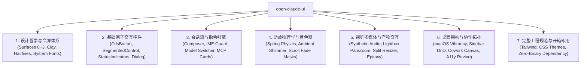

# Open Claude UI (`open-claude-ui`)

<p align="center">
  
</p>

<p align="center">
  <strong>Production-grade, clean-room reverse-engineered implementation of the Claude Design System (CDS) and interaction physics.</strong>
</p>

<p align="center">
  <a href="LICENSE"></a>
  <a href="assets/README.md"></a>
  <a href="https://www.typescriptlang.org/"></a>
  <a href="https://react.dev/"></a>
  <a href="https://tailwindcss.com/"></a>
  <a href="https://www.framer.com/motion/"></a>
</p>

---

## 📖 简介 (Introduction)

`open-claude-ui` 是基于对现代桌面端 AI 客户端进行深度洁净室逆向工程（Clean-Room Reverse Engineering）构建的高保真开源 UI 组件库与动效引擎。

不同于市面上常见的盲猜或近似复刻，本项目所有组件规范、物理阻尼常数、着色器关键帧及音频管道均**严格依据真实前端架构反编译验证**提炼而成：
* **温润的人文质感 (Editorial Warmth)**：纯正陶土橙（Clay `#d97757`）、4 层微对比表面阶梯（Surface 0~3）与视网膜高分屏发丝细边补偿（Hairline Ring）；
* **严苛的交互物理学 (Interaction Physics)**：二阶阻尼谐振子数学求解、4px 指针移动死区、CJK 输入法合成守卫、7 阶五次缓动 Alpha 遮罩；
* **高阶视听与系统架构 (Audiovisual & Architecture)**：基于原生 Web Audio API 的零延迟合成提示音、以光标为锚点的画廊跑道平移缩放、macOS 桌面毛玻璃透明融合与 Cowork 多代理协同拓扑。

> ⚖️ **版权与合规声明 (DMCA & Assets Policy)**：  
> 本开源项目**不公开分发任何专有二进制资产**（包括商业字体 `.ttf` 与录音 `.mp3`）。本项目提供原生系统级字体回退栈与 Web Audio API 纯代码合成音效，完全自包含、合规安全。详情参见 [assets/README.md](assets/README.md)。

---

## 🌟 核心特性 (Key Features)



1. **28 个生产级独立代码模块**：包含 11 个基础原子控件 + 17 个深度架构物理学模块与 React Hooks，即拷即用，零黑盒依赖。
2. **纯原生系统级排版与音效**：支持系统高保真字体回退栈，内置基于 Web Audio 振荡器的零延迟提示音合成引擎。
3. **交互式组件故事书 (Storybook Preview)**：内置单文件开箱即用的离线 Storybook，支持浏览器直接打开预览全部组件动效。
4. **七大领域分卷完整技术手册**：附带深度逆向分析开发手册 [`docs/Claude Design System (CDS).md`](docs/Claude%20Design%20System%20(CDS).md)。

---

## 📂 项目结构 (Repository Structure)

```
open-claude-ui/
├── assets/                           # 资产说明与合规指引
│   ├── images/logo.svg               # 开源矢量标识
│   └── README.md                     # 资产合规与系统级回退栈说明
├── code-examples/                    # 30 个生产级独立代码文件 (开箱即用)
│   ├── ArtifactsSplitPaneResizer.tsx # 双栏弹性分割与折叠引擎
│   ├── AttachmentCard.tsx            # 附件磁贴与上下文胶囊
│   ├── cds-theme.css                 # 全局主题样式表 (CSS 自定义属性与 Keyframes)
│   ├── CdsButton.tsx                 # 4 级尺寸、5 大变体全能按钮
│   ├── ChatComposer.tsx              # 核心输入框终端
│   ├── ChatMessageBubbles.tsx        # 会话气泡套件 (User & Assistant)
│   ├── ClaudeAudioPlayer.ts          # 低延迟音频引擎 (内置 Web Audio 原生合成振荡器)
│   ├── ClaudeDesktopHeader.tsx       # macOS 沉浸式标题栏组件
│   ├── ClaudeMotionPresets.ts        # 动效引擎与二阶阻尼谐振子数学求解
│   ├── CodeBlock.tsx                 # 代码块容器与 2.5s 复制衰减状态机
│   ├── ConfirmationDialog.tsx        # 模态确认对话框
│   ├── ContainerResponsiveBar.tsx    # 自适应容器查询响应栏
│   ├── CoworkAgentCanvas.tsx         # 多智能体协同看板与拓扑空间
│   ├── createClaudeMainWindow.ts     # Electron 宿主主窗口创建工厂
│   ├── DraggableSessionList.tsx      # 侧边栏会话拖放与固定物理
│   ├── EpitaxyIframeBridge.tsx       # Artifacts 预览沙箱桥接器
│   ├── LiveMicActivityBars.tsx       # 6 频段非线性麦克风波形柱
│   ├── McpToolDecisionCard.tsx       # MCP 交互式工具调用决策卡片
│   ├── MediaLightboxViewer.tsx       # 多模态媒体查看器与画廊跑道
│   ├── ModelSwitcherWithTokenGauge.tsx # 模型矩阵选择器与 Token 仪表盘
│   ├── ReasoningAmbientGlow.tsx      # 动态光效与推理氛围感组件
│   ├── RichComposerWithMentions.tsx  # CJK 守卫、/ 与 @ 双触发符输入终端
│   ├── ScrollFadeContainer.tsx       # 7 阶五次缓动非线性 Alpha 渐变遮罩
│   ├── SegmentedControl.tsx          # 999px 全圆角分段选择胶囊
│   ├── StatusIndicators.tsx          # 陶土呼吸灯、运行脉冲与骨架屏扫光
│   ├── StreamingDiffViewer.tsx       # 代码差异对比与流式高亮引擎
│   ├── tailwind.config.js            # Tailwind 配置工程扩展
│   ├── ThinkingAccordion.tsx         # 思考过程状态机折叠组件
│   ├── useClaudeRovingFocus.ts       # 全键盘无障碍焦点漫游 Hook
│   ├── useClaudeScrollPinning.ts     # 流式滚动视口图钉 Hook
│   ├── useClaudeSharedElementTransition.ts # View Transitions 共享元素变形 Hook
│   └── useRateLimitBackoff.ts        # 429/503 指数退避与熔断状态机 Hook
├── docs/
│   ├── Claude Design System (CDS).md # 七大篇章 / 31 小节深度技术指导手册
│   └── claude-components-storybook.html # 交互式可视化故事书 (双击即可离线体验)
├── src/
│   └── index.ts                      # 统一对外导出的 TypeScript 库入口
├── package.json
├── tsconfig.json
└── README.md
```

---

## 🧩 生产级组件与物理模块总览 (Component Directory)

| 模块分类 | 组件 / Hook 文件 | 逆向来源与工程机制 |
| :--- | :--- | :--- |
| **基础原子控件** | `CdsButton.tsx` | 4 级尺寸阶梯（XS/SM/MD/LG），5 大变体，单闭合边框原则，`active:scale-[0.98]`。 |
| **基础原子控件** | `SegmentedControl.tsx` | 999px 全圆角轨道、2px 几何内边距、纯几何定位与 Framer Motion 双模式。 |
| **基础原子控件** | `StatusIndicators.tsx` | 陶土明度呼吸指示灯（2.4s）、运行活动脉冲（1.2s）、思考跳动三点与骨架屏扫光条。 |
| **基础原子控件** | `ConfirmationDialog.tsx` | 16px 圆角、双环 Popover 弥散投影、高斯模糊遮罩与按键陷阱。 |
| **基础原子控件** | `AttachmentCard.tsx` | 10px 面板圆角、桌面端磁贴 (128×96px) 与输入框行内胶囊双模式、生长入场动画。 |
| **会话流与输入** | `ChatMessageBubbles.tsx` | User 18px 浅蓝微调底色 vs Assistant 零边框透明排版与代码块联动。 |
| **会话流与输入** | `ThinkingAccordion.tsx` | CSS Grid `0fr -> 1fr` 弹性伸缩无抖动动画，生成中强制展开互斥锁。 |
| **会话流与输入** | `RichComposerWithMentions.tsx` | CJK 输入法合成守卫（`isComposing || keyCode === 229`）、`/` 指令与 `@` 上下文双触发符、Token 预测。 |
| **会话流与输入** | `ModelSwitcherWithTokenGauge.tsx` | 三大模型梯队切换、Extended Thinking 开关、Prompt Caching 四色显存解构与 SVG 环形表。 |
| **会话流与输入** | `McpToolDecisionCard.tsx` | 三态授权生命周期（`pending_approval` $\to$ `running` $\to$ `success`/`error`）、三阶决议动作阵列。 |
| **动效与环境光** | `ClaudeMotionPresets.ts` | 二阶阻尼谐振子数学求解（$m\ddot{x} + c\dot{x} + kx = 0$）、4 大弹簧预设与贝塞尔常量。 |
| **动效与环境光** | `ReasoningAmbientGlow.tsx` | `wl-glow` 陶土暖光漫反射、`cds-shimmer-text-shine` 非对称贝塞尔曲线、焦散光场。 |
| **动效与环境光** | `ScrollFadeContainer.tsx` | 官方 7 阶五次缓动非线性 Alpha 渐变遮罩、动态滚动位置传感器（触顶/触底动态归零）。 |
| **视听与多模态** | `ClaudeAudioPlayer.ts` | 原生 Web Audio API 合成振荡器、24kHz 声学通道、15ms 平滑淡入淡出增益防爆音。 |
| **视听与多模态** | `LiveMicActivityBars.tsx` | 6 柱波形、`Math.pow(energy, 0.7)` 非线性 Gamma 能量压缩、8% 噪声门限过滤。 |
| **视听与多模态** | `MediaLightboxViewer.tsx` | 75vw 跑道滑动位移、以光标为锚点的仿射平移缩放（Pan/Zoom）、4px 拖拽死区、Ctrl 滚轮缩放。 |
| **视听与多模态** | `useClaudeSharedElementTransition.ts` | 基于 `startViewTransition`、缩略图动态圆角检测与 `object-fit: contain` 内切剪裁逆向计算。 |
| **视听与多模态** | `ArtifactsSplitPaneResizer.tsx` | Iframe 事件防吞噬护盾、4px 移动死区、双击 50/50 居中吸附、边缘折叠门限与约束钳制。 |
| **视听与多模态** | `EpitaxyIframeBridge.tsx` | 严格 Origin 校验与通道隔离的 postMessage RPC 协议、7 大专有 MIME 分发、用户激活门禁。 |
| **视听与多模态** | `StreamingDiffViewer.tsx` | Shadow DOM 隔离、CSS Grid 行高对齐锁定、增量流式追加、统一/分屏双模式。 |
| **视听与多模态** | `CodeBlock.tsx` | 12px 圆角、`#0d0d0c` 纯黑底色、语言标签行内光学对齐、2.5 秒复制衰减状态机。 |
| **系统与协作拓扑** | `createClaudeMainWindow.ts` | Electron 宿主窗口工厂：`hiddenInset` 标题栏、macOS Vibrancy (`under-window`) 毛玻璃融合。 |
| **系统与协作拓扑** | `ClaudeDesktopHeader.tsx` | macOS 交通灯 76px 安全边距（`-webkit-app-region: drag`）、多标签页切换胶囊。 |
| **系统与协作拓扑** | `DraggableSessionList.tsx` | `pinnedOrder` 乐观拓扑重排、4px 指针移动死区、微倾斜幽灵投影与落点对撞占位线。 |
| **系统与协作拓扑** | `CoworkAgentCanvas.tsx` | 多 Agent 任务委派状态机、团队共享工件网格资产池、`BroadcastChannel` 跨窗口同步。 |
| **系统与协作拓扑** | `useClaudeScrollPinning.ts` | 150ms 冷却时间戳防抢夺、40px 底部容差图钉锁定、35vh 弹性缓冲与 GPU 字符模糊消解。 |
| **系统与协作拓扑** | `ContainerResponsiveBar.tsx` | 基于 `@container` 的紧凑 (<254px)、中等 (255-420px) 与宽屏 (>420px) 渐进排版，杜绝单字折行。 |
| **系统与协作拓扑** | `useClaudeRovingFocus.ts` | W3C WAI-ARIA 规范：方向键二维与一维网格漫游导航、Home/End 边界快速跳跃、RTL 翻转。 |
| **系统与协作拓扑** | `useRateLimitBackoff.ts` | 429/503 截断指数退避（$t = \min(t_{\max}, t_{\text{base}} \times 2^a) \times (1 \pm J)$）、全抖动与熔断。 |

---

## 🚀 快速上手 (Quick Start)

### 1. 引入样式表与 Tailwind 配置

在你的项目中引入 CDS 核心主题样式表：
```css
/* 引入全局主题变量与关键帧 */
@import "open-claude-ui/code-examples/cds-theme.css";
```

在你的 `tailwind.config.js` 中扩展主题：
```javascript
const cdsTheme = require("open-claude-ui/code-examples/tailwind.config.js");

module.exports = {
  content: [
    "./src/**/*.{js,ts,jsx,tsx}",
    "./node_modules/open-claude-ui/**/*.{js,ts,jsx,tsx}"
  ],
  theme: {
    extend: {
      ...cdsTheme.theme.extend
    }
  }
};
```

### 2. 使用核心组件

```tsx
import React, { useState } from 'react';
import { 
  ChatComposer, 
  CdsButton, 
  ModelSwitcherWithTokenGauge, 
  ScrollFadeContainer 
} from 'open-claude-ui';

export function App() {
  const [model, setModel] = useState<'sonnet-3.5' | 'haiku-3.5' | 'opus-3'>('sonnet-3.5');
  const [thinking, setThinking] = useState(true);

  return (
    <div className="flex h-screen w-full bg-[var(--cds-surface-1)]">
      <ScrollFadeContainer axis="vertical" fadeSize={32} className="flex-1 p-6">
        <div className="mx-auto max-w-3xl space-y-4">
          <ModelSwitcherWithTokenGauge
            currentModel={model}
            onModelChange={setModel}
            extendedThinking={thinking}
            onThinkingChange={setThinking}
            tokenBudget={{
              inputTokens: 12400,
              outputTokens: 3200,
              cacheReadTokens: 48000,
              cacheWriteTokens: 16000,
              maxContextWindow: 200000
            }}
          />
          <ChatComposer onSend={(text) => console.log('Send message:', text)} />
        </div>
      </ScrollFadeContainer>
    </div>
  );
}
```

---

## 🎨 视觉故事书预览 (Interactive Storybook)

无需启动繁重的本地服务器，只需双击打开自带的 HTML 文件即可体验全量高保真组件：
```bash
open docs/claude-components-storybook.html
```
故事书包含：
* 陶土色彩体系与暗黑模式即时切换
* 全量按钮尺寸与悬浮反馈
* 999px 全圆角滑动分段胶囊
* 二阶弹簧动效实时演示
* 附件磁贴与代码复制衰减状态机

---

## 📄 完整技术手册 (Documentation)

完整的七大篇章逆向分析手册请查阅：[`docs/Claude Design System (CDS).md`](docs/Claude%20Design%20System%20(CDS).md)。
- **第一篇**：设计哲学与设计令牌体系
- **第二篇**：基础原子组件与交互控件
- **第三篇**：会话核心流与指令交互引擎
- **第四篇**：动效物理学、着色器与环境光影
- **第五篇**：视听多媒体与产物交互物理学
- **第六篇**：系统级桌面架构与协作拓扑
- **第七篇**：工程配置与资产代码库总览

---

## 📜 许可证 (License)

本项目基于 [MIT License](LICENSE) 开源发布。所有反编译研究成果与代码复现仅供学习、研究与工程交流使用。
